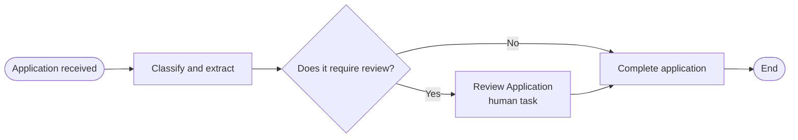
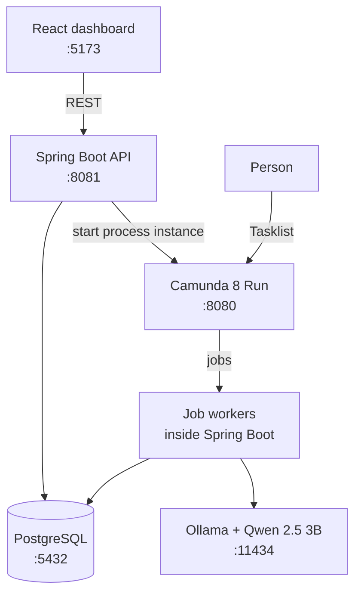

# Request Manager


**AI-powered request processing with Spring Boot, Camunda 8 and a local language model.**

Users submit requests written in natural language (an invoice question, a complaint, an incident...). A locally running model classifies each request, extracts the amount and writes a short summary. A Camunda 8 BPMN process then decides whether the request can be completed automatically or needs a **human review**. A React dashboard shows the status of every request in near real time.

> **Status:** working end to end on a local environment. It is a learning and demonstration project, not a production-ready system.

## Features

- **REST API** to create requests and list them (`POST` / `GET /api/requests`).
- **Local AI classification** with Ollama and Qwen 2.5 3B: category, confidence score, extracted amount and a one-line summary. No data leaves your machine.
- **Workflow orchestration** with Camunda 8 and BPMN, using job workers inside the Spring Boot application.
- **Human-in-the-loop review:** requests with low confidence, or classified as `OTHER`, wait for a person in Camunda Tasklist.
- **PostgreSQL persistence** for requests and their processing results.
- **React + TypeScript dashboard** with request metrics, a submission form and a table that refreshes every five seconds.

## How it works



1. The client sends a request to `POST /api/requests`. The API stores it in PostgreSQL with status `RECEIVED` and starts the BPMN process `process-application`, passing the request ID.
2. The **`classify-application`** worker loads the request, asks the local model for a category (`INVOICE`, `COMPLAINT`, `INCIDENT` or `OTHER`), a confidence score, an amount and a summary, and saves them.
3. The worker sets `reviewRequired` to `true` when the score is below the configured threshold (`tramitador.umbral`, default `0.8`) or the category is `OTHER`. In that case the status becomes `IN_REVIEW`.
4. The exclusive gateway routes the request: straight to completion, or to the **Review Application** user task.
5. The **`finalize-application`** worker marks the request as `COMPLETED` and records whether a person reviewed it.

### Architecture



## Technology stack

| Technology | Purpose |
|---|---|
| Java 21, Spring Boot 4.1 | Backend and REST API |
| Spring Data JPA / Hibernate | Persistence |
| PostgreSQL | Relational database |
| Spring AI 2.0 + Ollama | Calling the local language model |
| Qwen 2.5 3B (`qwen2.5:3b`) | Classification and summarisation |
| Camunda 8 (Spring Boot starter 8.10) | Workflow engine and job workers |
| Camunda Modeler | BPMN design (process modelled for Camunda 8.9) |
| React 19, TypeScript, Vite | Frontend dashboard |
| Maven (wrapper included) | Build |
| JUnit 5, Mockito, AssertJ | Unit and web-layer tests |
| Testcontainers | Repository tests against a real PostgreSQL |
| Vitest, Testing Library | Frontend tests |
| GitHub Actions | Continuous integration |

## Getting started

### Prerequisites

- JDK 21
- Docker (for PostgreSQL)
- [Ollama](https://ollama.com)
- Camunda 8 Run (local Camunda 8 cluster) and Camunda Modeler
- Node.js (a recent LTS version, see [Vite's requirements](https://vite.dev))

Default ports:

| Service | Port |
|---|---:|
| React dashboard (Vite) | `5173` |
| Spring Boot API | `8081` |
| PostgreSQL | `5432` |
| Ollama | `11434` |
| Camunda 8 Run (Operate, Tasklist) | `8080` |

### 1. Clone the repository

```bash
git clone https://github.com/ClaudiaCalero/application-processor-ia-camunda.git
cd application-processor-ia-camunda
```

### 2. Start PostgreSQL

```bash
docker run --name pg-tramitador \
  -e POSTGRES_DB=tramitador \
  -e POSTGRES_USER=postgres \
  -e POSTGRES_PASSWORD=postgres \
  -p 5432:5432 \
  -d postgres:16
```

These credentials are for local development only. If the container already exists, run `docker start pg-tramitador`.

### 3. Start Ollama and download the model

```bash
ollama pull qwen2.5:3b
```

Make sure Ollama is running at `http://localhost:11434`.

### 4. Start Camunda 8 Run and deploy the process

1. Start Camunda 8 Run following the official instructions.
2. Open `src/main/resources/bpmn/tramitar-solicitud.bpmn` in Camunda Modeler.
3. Deploy it to your local cluster (the rocket icon in the bottom bar).

The application does not deploy the BPMN file by itself. The process ID is `process-application` and the workers expect the task types `classify-application` and `finalize-application`.

### 5. Run the backend

```bash
./mvnw spring-boot:run        # Windows: .\mvnw.cmd spring-boot:run
```

Check that it is up: `http://localhost:8081/api/health` should return `{"status":"OK", ...}`.

### 6. Run the frontend

```bash
cd frontend
npm install
npm run dev
```

Open `http://localhost:5173`. The API URL defaults to `http://localhost:8081` and can be changed with the `VITE_API_URL` environment variable.

### 7. Try it

- *"I received an invoice for 150 euros that appears to be incorrect."* is classified as an invoice and completes automatically.
- *"I need help with something, but I am not sure what kind of request this is."* is classified as `OTHER`, so it goes to human review.

## Human review

When a request needs review, its status is `IN_REVIEW` and a **Review Application** task appears in Camunda Tasklist (`http://localhost:8080/tasklist`). Open it, assign it to yourself and complete it. The process then runs the final step: the request becomes `COMPLETED` and the dashboard shows **Human review: Yes**.

The review task does not have a form yet, so a reviewer can approve a request but cannot correct its category (see the roadmap).

## API

### Create a request

`POST /api/requests`

```json
{
  "text": "I received an invoice for 150 euros that appears to be incorrect."
}
```

```bash
curl -X POST http://localhost:8081/api/requests \
  -H "Content-Type: application/json" \
  -d '{"text": "I received an invoice for 150 euros that appears to be incorrect."}'
```

```powershell
Invoke-RestMethod -Uri "http://localhost:8081/api/requests" -Method Post `
  -ContentType "application/json" `
  -Body (@{ text = "I received an invoice for 150 euros that appears to be incorrect." } | ConvertTo-Json)
```

The request text is required and limited to 5,000 characters (`400` otherwise). The response is the saved request. Classification fields are filled in a few seconds later, once the workflow has run.

### List requests

`GET /api/requests` returns all requests, newest first.

Example of a processed request (illustrative; actual output depends on the model):

```json
{
  "id": 2,
  "text": "I received an invoice for 150 euros that appears to be incorrect.",
  "category": "INVOICE",
  "score": 1.0,
  "summary": "Request about an invoice for 150 euros",
  "amount": 150.0,
  "status": "COMPLETED",
  "reviewedByPerson": false,
  "createdAt": "2026-10-28T10:15:30Z"
}
```

Statuses: `RECEIVED`, `IN_REVIEW`, `COMPLETED`.

### Health check

`GET /api/health`

## Configuration

Main settings in `src/main/resources/application.yaml`:

| Property | Default | Description |
|---|---|---|
| `server.port` | `8081` | API port |
| `spring.datasource.url` | `jdbc:postgresql://localhost:5432/tramitador` | Database connection |
| `spring.datasource.username` / `password` | `postgres` / `postgres` | Local development credentials |
| `spring.ai.ollama.base-url` | `http://localhost:11434` | Ollama endpoint |
| `spring.ai.ollama.chat.options.model` | `qwen2.5:3b` | Model used for classification |
| `tramitador.umbral` | `0.8` | Confidence threshold below which a request goes to review |

No Camunda settings are defined: the application relies on the client defaults, which work with a default local Camunda 8 Run. For any other setup, add the relevant `camunda.client.*` properties (see the Camunda documentation).

## Project structure

```text
.
├── src/main/java/com/claudia/tramitador/
│   ├── controller/   REST controllers (requests, health)
│   ├── dto/          Request payloads
│   ├── entity/       JPA entity (Request)
│   ├── enums/        RequestStatus, RequestCategory
│   ├── model/        Classification (AI response)
│   ├── repository/   Spring Data repository
│   └── service/      AIClassifier and Camunda job workers
├── src/main/resources/
│   ├── application.yaml
│   └── bpmn/tramitar-solicitud.bpmn
├── src/test/         Unit, web-layer and repository tests
├── frontend/         React + TypeScript dashboard (Vite)
├── .github/workflows/ci.yml   CI pipeline
└── pom.xml
```

## Testing

The project has **42 automated tests** that run on every push through GitHub Actions.

| Layer | Tests | What it covers | Tools |
|---|---:|---|---|
| Workers (unit) | 15 | Review rule (score below threshold, category `OTHER`), the threshold boundary, amount and summary handling, model failure, retries of the same job | JUnit 5, Mockito, AssertJ |
| REST controller | 14 | Validation limits (5000 / 5001 characters, blank, malformed JSON), process start, `503` when Camunda is down, the JSON contract used by the frontend, CORS | Spring MockMvc |
| Repository | 5 | Default values, enum stored as text, newest-first ordering, column lengths | Testcontainers (PostgreSQL) |
| Frontend | 8 | Table formatting, metric cards, error handling, form submission, polling | Vitest, Testing Library |

Run them locally:

```bash
./mvnw test                  # Windows: .\mvnw.cmd test (Docker must be running for the repository tests)
cd frontend && npm test      # frontend
```

The repository tests start a throwaway PostgreSQL container and never touch the development database.

## Known limitations

- **Small local model:** Qwen 2.5 3B is fast and private, but its confidence scores and extracted values are only indicative. That is why the review rule also sends every `OTHER` request to a person.
- **Workflow start is compensated, not transactional:** if Camunda is unavailable when a request is created, the API deletes the saved request and answers `503`. A crash between saving and starting the process could still leave a request in `RECEIVED`.
- **No form in the review task yet,** so categories cannot be corrected from Tasklist.
- **Local only:** there is no authentication, no Docker setup for the application itself and no production configuration.

## Roadmap

- [x] REST API with PostgreSQL persistence
- [x] Local AI classification with Ollama
- [x] BPMN workflow with classification and finalisation workers
- [x] Human review through Camunda Tasklist
- [x] React dashboard
- [ ] Review form to correct the category
- [x] Handle a failed workflow start
- [x] Worker, controller, repository and frontend tests
- [ ] Model evaluation set (`scripts/evaluate.ps1`)
- [x] CI with GitHub Actions

## About this project

This is a learning project about how a backend application is designed, built and debugged: REST APIs, JPA, BPMN workflows and workers, human-in-the-loop processing and integrating a locally hosted language model. AI assistants, tutorials and documentation were used as learning resources, with the goal of understanding the implementation and the decisions behind it.

AI-generated classifications and extracted values can be wrong and should be validated before being used for any consequential decision.
